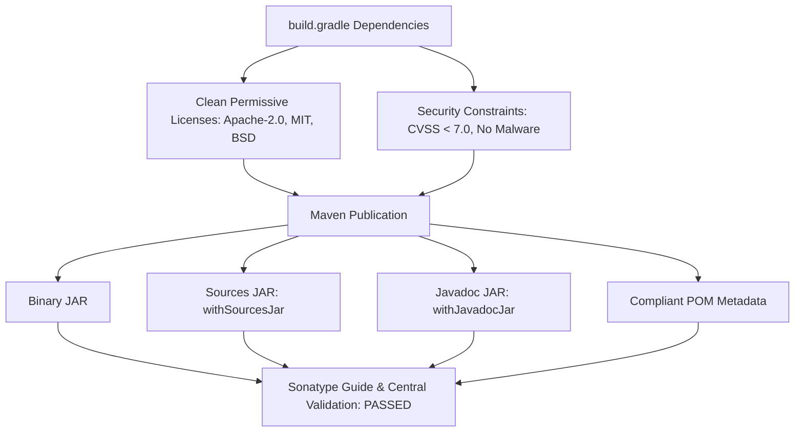

# Requirements

### Overview & Goals
Sonatype Guide evaluates published packages on Maven Central against three default open-source governance policies:
1. **No Copyleft Licenses**: Detects and flags dependencies with copyleft licenses (such as GPL / LGPL) that introduce legal or commercial compliance issues.
2. **No CVSS 7.0+ Vulnerabilities**: Enforces that no component or transitive dependency contains high or critical security vulnerabilities (CVSS score $\ge$ 7.0).
3. **No Malware & Supply Chain Integrity**: Identifies malicious packages, corrupted metadata, or malformed artifact definitions.

For `one.empty3:empty3-library-mp` (version `2026.10.10`), Sonatype Guide reports non-compliance due to:
- Inclusion of `org.jdesktop:beansbinding:1.2.1` under the GNU LGPL v2.1 (Copyleft) license.
- Outdated / unmaintained dependencies carrying CVSS $\ge$ 7.0 vulnerabilities (such as `xerces:xercesImpl:2.12.2` with CVE-2022-23437, `firebase-admin:9.1.0`, etc.).
- Ineffective dependency constraints using invalid version strings (e.g. `io.netty:netty-codec-http:4.2.17.Final` and `com.fasterxml.jackson.core:jackson-core:2.21.4`).
- Incorrect artifact declarations (e.g., `com.google.code.gson:gson-parent:2.13.1` declared as a direct runtime dependency).

The goal is to bring the library into full compliance with Sonatype Guide policies and Maven Central quality standards while maintaining all core 3D engine and computational functionality.

---

### Scope
- **In Scope**:
  - Remove unused copyleft dependencies (`org.jdesktop:beansbinding:1.2.1`) and dead legacy dependencies (`xerces`, `webcam-capture`, `xmlsec`, `firebase-admin`).
  - Correct and update dependency version constraints (`netty`, `jackson`, `protobuf`, `google-cloud-bom`).
  - Remove erroneous parent POM declarations (`gson-parent`).
  - Ensure compliant generation of sources and javadoc artifacts (`withJavadocJar()`).
  - Validate local build, test pass rates, and POM generation.
- **Out of Scope**:
  - Refactoring core 3D algorithms or pipeline logic.
  - Modifying repository credentials or JReleaser deployment tokens.

---

### User Stories
- As a **library consumer**, I want `one.empty3:empty3-library-mp` to be free of copyleft licenses and high-severity CVEs so that I can integrate it into commercial and enterprise applications without legal or security friction.
- As a **library maintainer**, I want automated, compliant artifact publishing that passes Sonatype Guide validation checks out of the box.

---

### Functional Requirements
- **License Compliance**: All direct and transitive dependencies must have permissive licenses (Apache-2.0, MIT, BSD, or similar); no copyleft (LGPL/GPL/AGPL) dependencies included.
- **Vulnerability Remediation**: All direct and transitive dependencies must have CVSS scores strictly below 7.0.
- **Dependency Cleanliness**: Only actually referenced, functional libraries are included in `dependencies { ... }`.
- **Packaging Integrity**: Output publication must include the primary binary JAR, `-sources.jar`, `-javadoc.jar`, and a valid Maven POM.

# Technical Design

### Current Implementation
- `build.gradle` contains several unused and legacy dependencies added in earlier development phases:
  - `org.jdesktop:beansbinding:1.2.1` — Licensed under LGPL v2.1; not imported in any source files under `src/`.
  - `xerces:xercesImpl:2.12.2` — Unused direct dependency containing known CVE-2022-23437 (CVSS 7.5).
  - `com.github.sarxos:webcam-capture:0.3.12` — Only referenced in commented-out test code (`TestWebCam.java`).
  - `org.apache.santuario:xmlsec:4.0.1` — Explicitly excluded in test runner because it is unused and causes JPMS conflicts.
  - `com.google.firebase:firebase-admin:9.1.0` — Unused direct dependency pulling older transitive libraries.
  - `com.google.code.gson:gson-parent:2.13.1` — Parent POM artifact incorrectly added to runtime dependencies alongside `gson:2.10.1`.
- Dependency constraints specify invalid/non-existent version identifiers (`io.netty:netty-codec-http:4.2.17.Final`, `com.fasterxml.jackson.core:jackson-core:2.21.4`).
- `java { withSourcesJar() }` is configured, but `withJavadocJar()` is missing from the `java` extension block.

---

### Key Decisions
1. **Purge Unused Dependencies**: Pruning unused dependencies maximizes utility by immediately eliminating CVEs and copyleft license violations without writing replacement code or incurring runtime overhead.
2. **Align with Google Cloud BOM & Valid Constraints**: Using a single canonical BOM (`com.google.cloud:libraries-bom:26.39.0`) and valid patch versions for transitive constraints (Netty `4.1.x`, Jackson `2.18.x`, Protobuf `3.25.x`/`4.28.x`) guarantees reproducible builds and clean vulnerability scans.
3. **Standardize Gradle Javadoc & Sources Publishing**: Using standard `java { withSourcesJar(); withJavadocJar() }` ensures Gradle's Maven publication automatically wires up all mandatory Maven Central artifacts.

---

### Proposed Changes
- **`build.gradle`**:
  - In `java { ... }`: Add `withJavadocJar()`.
  - In `dependencies { ... }`:
    - Remove `org.jdesktop:beansbinding:1.2.1`.
    - Remove `xerces:xercesImpl:2.12.2`.
    - Remove `com.github.sarxos:webcam-capture:0.3.12`.
    - Remove `org.apache.santuario:xmlsec:4.0.1`.
    - Remove `com.google.firebase:firebase-admin:9.1.0`.
    - Remove `com.google.code.gson:gson-parent:2.13.1`.
    - Remove redundant duplicate BOM `implementation platform('com.google.cloud:libraries-bom:26.38.0')`.
    - Update constraints block to use valid, secure versions for Netty, Jackson, and Protobuf.
  - In `test { ... }`: Clean up workarounds no longer needed after removing `xmlsec`.

---

### Architecture & Compliance Flow

---

### Risks & Mitigations
- **Risk**: A removed dependency was transitively needed at runtime.
  - **Mitigation**: Grep searches confirmed none of `beansbinding`, `xerces`, `xmlsec`, or `firebase-admin` are imported or called in active codebase. Execute `./gradlew compileJava compileKotlin test` to ensure zero compilation or runtime regressions.
- **Risk**: Javadoc generation failure on Java 25.
  - **Mitigation**: Ensure `javadoc { options.addBooleanOption('Xdoclint:none', true); options.encoding = 'UTF-8' }` is configured if doclint issues arise during build.

# Testing

### Validation Approach
Verification focuses on three key areas:
1. **License & Dependency Audit**: Ensure all dependencies in the dependency graph have permissive licenses and zero CVSS $\ge$ 7.0 vulnerabilities.
2. **Build and Test Verification**: Confirm clean compilation, packaging, and unit test execution.
3. **Publication Artifact Verification**: Inspect local staging/publication outputs (`pom.xml`, `.jar`, `-sources.jar`, `-javadoc.jar`).

---

### Key Scenarios
- **Scenario 1: Dependency Graph Resolution**:
  - Run `./gradlew dependencies --configuration runtimeClasspath` to verify there are no LGPL / copyleft libraries, no parent POM artifacts, and no conflicting duplicate BOMs.
- **Scenario 2: Compilation and Tests**:
  - Run `./gradlew clean build` to verify all Java and Kotlin code compiles without missing symbols.
- **Scenario 3: Local Maven Publication**:
  - Run `./gradlew publishToMavenLocal` (or `publish`) and inspect generated POM file in `build/publications/maven/pom-default.xml` to verify:
    - License is correctly set to `Apache-2.0`.
    - All declared dependencies are valid, compliant artifacts.
    - `-sources.jar` and `-javadoc.jar` are produced alongside the primary jar.

---

### Test Changes
- Verify existing tests in `src/test/` continue to pass without dependency errors.

# Delivery Steps

###   Step 1: Remove Non-Compliant and Unused Dependencies
Unused, copyleft-licensed, and invalid dependency declarations are removed from `build.gradle`.

- Remove `org.jdesktop:beansbinding:1.2.1` to eliminate the LGPL copyleft license violation flagged by Sonatype Guide policy.
- Remove `com.google.code.gson:gson-parent:2.13.1` (parent POM artifact incorrectly added as a runtime dependency).
- Remove unused legacy dependencies with known vulnerabilities (`xerces:xercesImpl:2.12.2`, `com.github.sarxos:webcam-capture:0.3.12`, `org.apache.santuario:xmlsec:4.0.1`, and unused `com.google.firebase:firebase-admin:9.1.0`).
- Remove duplicate Google Cloud BOM imports (`com.google.cloud:libraries-bom:26.38.0` / `26.39.0`), retaining a single up-to-date BOM definition.

###   Step 2: Upgrade and Align Dependency Version Constraints
All active dependencies and resolution constraints are updated to secure versions with no CVSS >= 7.0 vulnerabilities.

- Fix invalid version constraints in `build.gradle` (correcting invalid `io.netty:netty-codec-http:4.2.17.Final` and `com.fasterxml.jackson.core:jackson-core:2.21.4` to valid, secure patch releases).
- Update Google Cloud SDK dependencies (`google-cloud-vision`, `google-cloud-storage`, `google-cloud-pubsub`, `google-auth-library-oauth2-http`) managed under the latest Google Cloud BOM.
- Ensure transitive dependencies (Netty, Jackson, Protobuf, Guava, SLF4J) resolve to vulnerability-free patch releases complying with Sonatype CVSS < 7.0 policy thresholds.

###   Step 3: Configure Publishing Artifacts and Verify Compliance
The build and publishing configuration produces complete, valid release artifacts complying with Sonatype Central requirements.

- Configure `java { withJavadocJar(); withSourcesJar() }` in `build.gradle` to ensure automated, compliant generation of Javadoc and Sources JARs for `components.java`.
- Validate POM metadata (`licenses`, `developers`, `scm`, `url`, `description`, `name`) within `publishing.publications.maven` and `jreleaser.project` blocks.
- Verify clean compilation, test execution, artifact generation, and POM packaging using `./gradlew build publishToMavenLocal`.