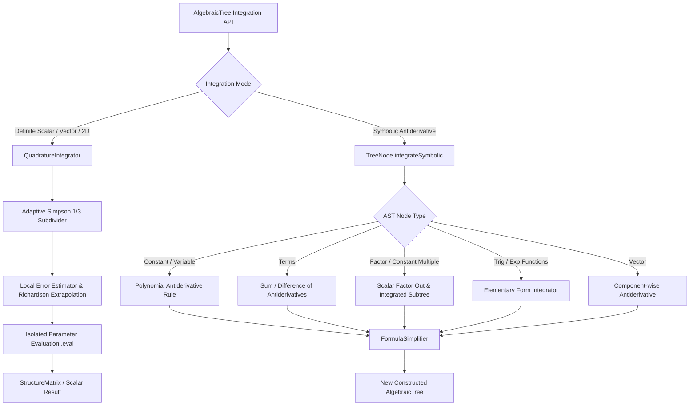

# Requirements

### Overview & Goals
Implementing integration functionality for `AlgebraicTree` provides foundational computational capabilities for geometry processing, parametric curve and surface analysis (e.g. arc lengths, surface areas, center of mass), physics simulations, and mathematical analysis in `one.empty3.library1.tree`.

The solution combines two complementary mechanisms:
1. **Adaptive Numerical Quadrature (Definite Integration)**: High-precision adaptive Simpson's quadrature for evaluating definite scalar integrals $\int_a^b f(x)\,dx$, vector integrals $\int_a^b \vec{r}(t)\,dt$, and iterated 2D double integrals $\iint_R f(x, y)\,dx\,dy$ across arbitrary integrable expressions.
2. **Symbolic Antiderivatives (Indefinite Integration)**: Exact symbolic integration producing a new constructed `AlgebraicTree` representing $F(x) = \int f(x)\,dx + C$ for standard polynomials, powers, exponential, trigonometric, and linear composite forms.

### Scope
- **In Scope**:
  - Definite 1D scalar numerical integration: `integrate(String var, double a, double b)` and `integrate(String var, double a, double b, double tolerance)`.
  - Definite 1D vector numerical integration: `integrateVector(String var, double a, double b)` and `integrateVector(String var, double a, double b, double tolerance)` returning a `StructureMatrix<Double>`.
  - Iterated 2D rectangular numerical integration: `integrate2D(String varX, double ax, double bx, String varY, double ay, double by, double tolerance)`.
  - Exact symbolic antiderivative computation: `antiderivative(String var)` / `TreeNode.integrateSymbolic(String var)`.
  - Symbolic integration rules for constants, power rule ($x^n \to \frac{x^{n+1}}{n+1}$ for $n \neq -1$, $x^{-1} \to \ln(|x|)$), linear terms ($u \pm v$), scalar multiplication ($c \cdot u(x)$), standard trigonometric ($\sin, \cos$), exponential ($\exp(kx)$), and vector component antiderivatives.
  - Formula simplification pass via `FormulaSimplifier` to normalize generated antiderivative expressions.
  - Automatic preservation and isolation of parameter environments during integration.
- **Out of Scope**:
  - Full non-elementary Risch decision algorithm for transcendental expressions.
  - Complex contour integration in the complex plane.
  - Monte Carlo integration over arbitrary non-rectangular multi-dimensional manifolds.

### User Stories
- **As a 3D graphics & geometry engineer**, I want to compute the arc length of parametric curves $L = \int_a^b \|\vec{r}'(t)\|\,dt$ and surface areas $A = \iint_R \left\| \frac{\partial S}{\partial u} \times \frac{\partial S}{\partial v} \right\|\,du\,dv$ directly using `AlgebraicTree.integrate(...)` and `AlgebraicTree.integrateVector(...)` so that geometric metrics are numerically exact and fast to compute.
- **As a math library user**, I want to obtain symbolic antiderivatives via `tree.antiderivative("x")` when analytical closed forms exist, and evaluate definite integrals seamlessly via `tree.integrate("x", a, b)` with configurable error tolerance.

### Functional Requirements
- `tree.integrate("x", a, b)` computes $\int_a^b f(x)\,dx$ using adaptive Simpson's quadrature with default tolerance $10^{-6}$.
- `tree.integrate("x", a, b, tol)` computes $\int_a^b f(x)\,dx$ to user-specified absolute/relative error tolerance `tol`.
- `tree.integrateVector("t", a, b)` computes component-wise definite integrals $\left[\int_a^b r_x(t)dt, \int_a^b r_y(t)dt, \dots\right]$.
- If $b < a$, the integrator respects the orientation $\int_a^b = -\int_b^a$, and if $a == b$, returns $0.0$.
- `tree.antiderivative("x")` returns a valid, non-null, constructed `AlgebraicTree` whose derivative satisfies $\frac{d}{dx}\left(\int f(x)dx\right) = f(x)$.
- Inherits parameter bindings (`parametersValues`, `parametersValuesVec`) without causing race conditions or side-effects on concurrent evaluations.

### Non-Functional Requirements
- **Performance & Convergence**: Adaptive subdivision concentrates sampling intervals only where local curvature/gradients are steep, bounding evaluations for smooth functions. Max recursion depth safeguard (e.g. depth 25) prevents call stack overflow on singularities.
- **Stability**: Local Richardson error extrapolation handles polynomial and trigonometric curves with $O(h^4)$ local convergence.

# Technical Design

### Current Implementation
In `one.empty3.library1.tree`:
- `AlgebraicTree`: Manages formula parsing, parameter state, tree construction, `eval()`, and symbolic `derivative(String var)`.
- `TreeNode` & subclasses (`DoubleTreeNodeType`, `VariableTreeNodeType`, `TermTreeNodeType`, `FactorTreeNodeType`, `PowerTreeNodeType`, `TreeTreeNode`, `TreeTreeNodeVector`): AST hierarchy supporting recursive evaluation, `toFormula()`, and `differentiate(var)`.
- `FormulaSimplifier`: Simplifies algebraic formulas by eliminating $0$ terms, identity products, sign cancellations, and redundant parentheses.

### Key Decisions

1. **Dedicated Quadrature Engine (`QuadratureIntegrator`)**:
   - Implement adaptive Simpson's 1/3 quadrature in a dedicated `QuadratureIntegrator` utility class.
   - Adaptive criterion: If $|S(a, m) + S(m, b) - S(a, b)| < 15 \cdot \epsilon$, accept $S(a, m) + S(m, b) + \frac{S(a, m) + S(m, b) - S(a, b)}{15}$ (Boole's / Richardson correction).
   - Component-wise vector quadrature evaluates `StructureMatrix<Double>` for vector expressions.

2. **AST-Based Symbolic Antiderivative Engine (`TreeNode.integrateSymbolic`)**:
   - Extend `TreeNode` with `public String integrateSymbolic(String variableName)`.
   - Dispatch to node type handlers:
     - Constants $c \implies c \cdot x$
     - Independent variables $y \implies y \cdot x$
     - Target variable $x \implies \frac{1}{2} \cdot x^2$
     - Power $x^n$ (const $n \neq -1$) $\implies \frac{1}{n+1} \cdot x^{n+1}$
     - Power $x^{-1}$ or $1/x \implies \ln(|x|)$
     - Terms $\int (u \pm v) \implies \int u \pm \int v$
     - Factor $c \cdot u(x)$ (constant multiplier) $\implies c \cdot \int u(x)$
     - Elementary functions $\sin(kx) \implies -\frac{1}{k}\cos(kx)$, $\cos(kx) \implies \frac{1}{k}\sin(kx)$, $\exp(kx) \implies \frac{1}{k}\exp(kx)$
     - Vector $[u, v, w] \implies [\int u, \int v, \int w]$
   - Pass result through `FormulaSimplifier.simplify(formula)` and instantiate new `AlgebraicTree`.

3. **Evaluation State Isolation**:
   - Quadrature evaluations clone or locally override target variable bindings in a thread-safe / non-destructive manner to preserve parent tree parameter values.

### Data Models / Contracts

```java
public class QuadratureIntegrator {
    public static final double DEFAULT_TOLERANCE = 1e-6;
    public static final int MAX_RECURSION_DEPTH = 25;

    public static double adaptiveSimpson(AlgebraicTree tree, String variableName, double a, double b, double tolerance);
    public static StructureMatrix<Double> adaptiveSimpsonVector(AlgebraicTree tree, String variableName, double a, double b, double tolerance);
    public static double integrate2D(AlgebraicTree tree, String varX, double ax, double bx, String varY, double ay, double by, double tolerance);
}
```

```java
public class AlgebraicTree extends Tree {
    // ... existing methods and fields ...

    /**
     * Computes the definite integral of this scalar expression across [a, b] using adaptive quadrature.
     */
    public double integrate(String variableName, double a, double b) {
        return integrate(variableName, a, b, QuadratureIntegrator.DEFAULT_TOLERANCE);
    }

    /**
     * Computes the definite integral of this scalar expression across [a, b] with specified error tolerance.
     */
    public double integrate(String variableName, double a, double b, double tolerance) {
        return QuadratureIntegrator.adaptiveSimpson(this, variableName, a, b, tolerance);
    }

    /**
     * Computes the definite component-wise integral of a vector expression across [a, b].
     */
    public StructureMatrix<Double> integrateVector(String variableName, double a, double b) {
        return integrateVector(variableName, a, b, QuadratureIntegrator.DEFAULT_TOLERANCE);
    }

    /**
     * Computes the definite component-wise integral of a vector expression across [a, b] with specified error tolerance.
     */
    public StructureMatrix<Double> integrateVector(String variableName, double a, double b, double tolerance) {
        return QuadratureIntegrator.adaptiveSimpsonVector(this, variableName, a, b, tolerance);
    }

    /**
     * Computes an iterated double integral over rectangular domain [ax, bx] x [ay, by].
     */
    public double integrate2D(String varX, double ax, double bx, String varY, double ay, double by, double tolerance) {
        return QuadratureIntegrator.integrate2D(this, varX, ax, bx, varY, ay, by, tolerance);
    }

    /**
     * Computes the symbolic antiderivative with respect to the specified variable.
     */
    public AlgebraicTree antiderivative(String variableName) {
        if (root == null) {
            construct();
        }
        String integralFormula = root.integrateSymbolic(variableName);
        integralFormula = FormulaSimplifier.simplify(integralFormula);
        AlgebraicTree integralTree = createWithSameParameters(integralFormula);
        integralTree.construct();
        return integralTree;
    }
}
```

### Architecture Diagram



# Testing

### Validation Approach
Verification combines analytical reference solutions, fundamental theorem of calculus round-trip checks ($\frac{d}{dx}\int f = f$), and geometric metric tests (arc length, surface area).

### Key Scenarios
1. **Definite Numerical Quadrature (Scalar)**:
   - Polynomial: $\int_0^2 (3x^2 + 2x + 1)\,dx = \left[x^3 + x^2 + x\right]_0^2 = 8 + 4 + 2 = 14.0$.
   - Trigonometric: $\int_0^\pi \sin(x)\,dx = 2.0$, $\int_0^{\pi/2} \cos(x)\,dx = 1.0$.
   - Exponential: $\int_0^1 \exp(x)\,dx = e - 1 \approx 1.718281828$.
   - Rational: $\int_0^1 \frac{1}{1 + x^2}\,dx = \arctan(1) = \frac{\pi}{4} \approx 0.785398163$.
   - Gaussian distribution integral: $\int_{-1}^1 \exp(-x^2)\,dx \approx 1.493648265$.
2. **Definite Numerical Quadrature (Vector)**:
   - Parametric circle: $\vec{r}(t) = (\cos t, \sin t, t)$, $\int_0^{\pi/2} \vec{r}(t)\,dt = (1.0, 1.0, \frac{\pi^2}{8})$.
3. **Parametric Arc Length & Geometric Integrals**:
   - Arc length of 3D helix: $\vec{r}(t) = (\cos t, \sin t, t)$, speed $v(t) = \sqrt{\sin^2 t + \cos^2 t + 1} = \sqrt{2}$. Arc length $\int_0^{2\pi} \sqrt{2}\,dt = 2\pi\sqrt{2} \approx 8.885765876$.
4. **2D Iterated Double Integral**:
   - $\iint_{[0,1]\times[0,1]} (x + y)\,dx\,dy = 1.0$.
   - $\iint_{[0,1]\times[0,2]} (x \cdot y^2)\,dx\,dy = \left(\int_0^1 x dx\right)\left(\int_0^2 y^2 dy\right) = \frac{1}{2} \cdot \frac{8}{3} = \frac{4}{3} \approx 1.333333333$.
5. **Symbolic Antiderivatives & Round-Trip Tests**:
   - $\int (4x^3 + 3x^2 - 2x + 5)\,dx = x^4 + x^3 - x^2 + 5x$.
   - $\int \sin(x)\,dx = -\cos(x)$, $\int \cos(x)\,dx = \sin(x)$, $\int \exp(x)\,dx = \exp(x)$.
   - Round-trip derivative consistency: for multiple test expressions $f(x)$, verify $\left(\int f(x)dx\right)'(x_0) == f(x_0)$ within $10^{-4}$.

### Edge Cases
- Inverted limits: $\int_2^0 f(x)dx = -\int_0^2 f(x)dx$.
- Zero-width intervals: $\int_a^a f(x)dx = 0.0$.
- High-gradient / steep curvature functions with adaptive refinement.
- Integrating constant expressions and multi-variable partial antiderivatives.

# Delivery Steps

### ✓ Step 1: Implement Adaptive Numerical Quadrature Engine (QuadratureIntegrator)
The `QuadratureIntegrator` provides robust, high-precision adaptive Simpson's quadrature for 1D scalar, vector, and 2D iterated integrals.

- Create `QuadratureIntegrator.java` in `one.empty3.library1.tree`.
- Implement recursive adaptive Simpson's 1/3 quadrature with local Richardson error estimation for scalar evaluation:
  $$S(a, b) = \frac{b - a}{6} \left[ f(a) + 4f\left(\frac{a+b}{2}\right) + f(b) \right]$$
- Implement recursive adaptive Simpson's rule for vector expressions returning `StructureMatrix<Double>`.
- Implement iterated 2D numerical integration `integrate2D` over rectangular domains $[a_x, b_x] \times [a_y, b_y]$.
- Implement boundary condition handling ($a = b \implies 0.0$, $b < a \implies -\int_b^a$), parameter value isolation, and recursion depth limit protection.

### * Step 2: Implement Symbolic Antiderivatives across AST Nodes and Simplification
The AST nodes support symbolic indefinite integration for common algebraic, polynomial, exponential, trigonometric, and vector expressions.

- Add `integrateSymbolic(String variableName)` to `TreeNode` and its subclasses:
  - `DoubleTreeNodeType`: $\int c\,dx = c \cdot x$.
  - `VariableTreeNodeType`: $\int x\,dx = \frac{1}{2} \cdot x^2$, $\int y\,dx = y \cdot x$ for $y \neq x$.
  - `PowerTreeNodeType`: power rule for $x^n \implies \frac{1}{n+1} \cdot x^{n+1}$ (for $n \neq -1$), $x^{-1} \implies \ln(\text{abs}(x))$.
  - `TermTreeNodeType`: sum/difference $\int (u \pm v)\,dx = \int u\,dx \pm \int v\,dx$.
  - `FactorTreeNodeType`: constant multiples $\int (c \cdot u(x))\,dx = c \cdot \int u(x)\,dx$.
  - `TreeTreeNode`: standard functions like $\sin(x) \to (-\cos(x))$, $\cos(x) \to \sin(x)$, $\exp(x) \to \exp(x)$.
  - `VectorTreeNode` / `TreeTreeNodeVector`: component-wise antiderivatives $[\int u, \int v, \int w]$.
- Enhance `FormulaSimplifier` to normalize generated fractions, constant products, and redundant brackets.

###   Step 3: Wire Public Integration APIs into AlgebraicTree and Add Automated Unit Tests
The public API of `AlgebraicTree` exposes scalar, vector, 2D quadrature, and symbolic antiderivatives, fully verified by JUnit 5 tests.

- Expose `integrate(...)`, `integrateVector(...)`, `integrate2D(...)`, and `antiderivative(...)` on `AlgebraicTree`.
- Create `AlgebraicTreeIntegrationTest` covering:
  - Scalar definite integrals across polynomial, trigonometric, exponential, and rational functions.
  - Component-wise vector definite integrals and arc-length / geometric surface area computations.
  - 2D double integrals over rectangular domains.
  - Symbolic antiderivatives and fundamental theorem of calculus round-trip validation ($\frac{d}{dx}(\int f(x)dx) = f(x)$).
- Execute test suite via Gradle to ensure clean pass and complete numerical accuracy.