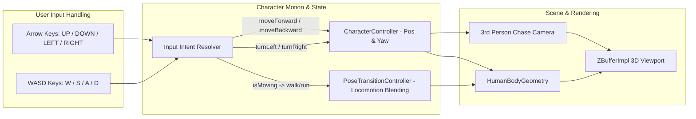

# Requirements

### Overview & Goals
Enhance the interactive control system in `InteractiveHumanRenderer2` to provide intuitive, responsive arrow-key navigation for character displacement and turning (`↑` forward, `↓` backward, `←` turn left, `→` turn right). Ensure directional consistency with camera perspective, support combined movement (e.g., turning while advancing), update the on-screen HUD guide, and validate all navigation behaviors through automated tests.

### Scope
- **In Scope**:
  - Full arrow-key mapping for character navigation:
    - `Up Arrow (VK_UP)`: Displace character forward along current heading vector.
    - `Down Arrow (VK_DOWN)`: Displace character backward along current heading vector.
    - `Left Arrow (VK_LEFT)`: Rotate character heading to the left (counter-clockwise yaw from top-down / camera perspective).
    - `Right Arrow (VK_RIGHT)`: Rotate character heading to the right (clockwise yaw from top-down / camera perspective).
  - Unified input handling with standard `WASD` controls (`W` = Up, `S` = Down, `A` = Turn Left, `D` = Turn Right, `Q`/`E` = Strafe).
  - Support simultaneous multi-key inputs (e.g., `Up + Left` for curving forward-left).
  - Automatic locomotion animation triggers (smooth transition to `walk` or `run` with `Shift` sprint modifier when arrow keys or WASD are engaged).
  - Updated HUD overlay and help documentation reflecting arrow-key controls.
  - Unit and integration tests covering arrow-key input processing, displacement calculations, and rotation sign correctness.
- **Out of Scope**:
  - Gamepad / joystick direct input mapping (remains keyboard and CLI driven).
  - Terrain collision and physics obstacle detection.

### User Stories
- **As a Player/User**, I want to control character movement using arrow keys (`↑` forward, `↓` backward, `←` turn left, `→` turn right) so that I can naturally navigate the 3D scene without being restricted to WASD.
- **As an Animator/Tester**, I want turning left and right to accurately match the visual camera perspective so that steering feels intuitive and predictable.
- **As an Interactive App User**, I want to see the arrow-key controls displayed on the HUD overlay so that the navigation scheme is immediately obvious.

### Functional Requirements
- **FR-1 (Arrow Key Forward/Backward Displacement)**:
  - Pressing `VK_UP` moves character forward at `moveSpeed * deltaSeconds` in the direction of the current yaw angle.
  - Pressing `VK_DOWN` moves character backward at `moveSpeed * 0.7 * deltaSeconds`.
- **FR-2 (Arrow Key Left/Right Rotation)**:
  - Pressing `VK_LEFT` rotates the character's heading to the left (counter-clockwise).
  - Pressing `VK_RIGHT` rotates the character's heading to the right (clockwise).
- **FR-3 (Locomotion Animation Blending)**:
  - When arrow keys or WASD produce non-zero displacement, automatically blend into `walk` (or `run` if `Shift` is held) within 0.3s.
  - When movement keys are released, maintain smooth completion or blend to idle/standing pose.
- **FR-4 (HUD Guidance Update)**:
  - Update `InteractiveGameWindow` HUD display string to explicitly list `Arrow Keys / WASD: Move & Turn`.

### Non-Functional Requirements
- **Responsiveness**: Zero input latency with smooth 60 FPS viewport rendering and instant multi-key response.
- **Consistency**: Exact mathematical parity between WASD navigation vectors and Arrow Key navigation vectors.
- **Maintainability**: Clean input-intent abstraction decoupling raw key codes from character motion physics.

# Technical Design

### Current Implementation
In `InteractiveHumanRenderer2.java`:
- `InteractiveGameWindow` captures key events via `activeKeys` (`ConcurrentHashMap.newKeySet()`).
- `updatePhysics(double deltaSeconds)` handles movement and turning.
- The coordinate transform is `rx = lx * cos(yaw) + lz * sin(yaw)` and `rz = -lx * sin(yaw) + lz * cos(yaw)`.
- When character faces forward (+Z), turning left requires decreasing yaw (so nose rotates towards -X), and turning right requires increasing yaw (so nose rotates towards +X), or vice versa depending on right-handed vs left-handed rotation convention.
- The current implementation binds both WASD and Arrow keys, but needs explicit validation of turn signs, explicit support for directional turn helper methods on `CharacterController`, and HUD documentation updates.

### Key Decisions
- **KD-1: Explicit Directional Turn Methods in `CharacterController`**:
  - Add `turnLeft(double angleRadians)` and `turnRight(double angleRadians)` to `CharacterController` to avoid ambiguous manual sign manipulation.
  - Ensure `VK_LEFT` / `VK_A` invokes `turnLeft` and `VK_RIGHT` / `VK_D` invokes `turnRight`.
- **KD-2: Unified Movement Intent Calculation**:
  - Compute normalized forward/backward axis (`[-1.0, 1.0]`) and turn axis (`[-1.0, 1.0]`) in `updatePhysics` from combined WASD and Arrow key states.
  - Apply displacement along heading vector `(sin(yaw), 0, cos(yaw))` and rotation around Y axis.
- **KD-3: Third-Person Chase Camera Alignment**:
  - Camera is positioned at `charPos + (-camDist * sin(yaw), camHeight, -camDist * cos(yaw))`, looking at character torso.
  - When turning left, camera smoothly rotates around character keeping the character's back in view.

### Proposed Changes
- **`CharacterController`**:
  - Add `turnLeft(double angleRadians)`: Decreases/adjusts yaw so character turns counter-clockwise (left in camera view).
  - Add `turnRight(double angleRadians)`: Increases/adjusts yaw so character turns clockwise (right in camera view).
  - Add `moveBackward(double distance)`: Moves in opposite direction of current facing.
- **`InteractiveGameWindow.updatePhysics`**:
  - Unify key checks:
    ```java
    boolean moveForward = activeKeys.contains(KeyEvent.VK_W) || activeKeys.contains(KeyEvent.VK_UP);
    boolean moveBackward = activeKeys.contains(KeyEvent.VK_S) || activeKeys.contains(KeyEvent.VK_DOWN);
    boolean turnLeft = activeKeys.contains(KeyEvent.VK_A) || activeKeys.contains(KeyEvent.VK_LEFT);
    boolean turnRight = activeKeys.contains(KeyEvent.VK_D) || activeKeys.contains(KeyEvent.VK_RIGHT);
    ```
  - Apply `character.turnLeft(turnAngle)` when `turnLeft` is active and `character.turnRight(turnAngle)` when `turnRight` is active.
- **`InteractiveGameWindow.RenderCanvas` HUD**:
  - Update control hints string: `"CONTROLS: Arrows/WASD to Move & Turn | Shift: Run | 1-6: Poses | C: Crouch | Z: Lie | R: Reset"`.

### Data Models / Contracts

```java
public class CharacterController {
    public synchronized void moveForward(double distance);
    public synchronized void moveBackward(double distance);
    public synchronized void strafe(double distance);
    public synchronized void turn(double angleDeltaRadians);
    public synchronized void turnLeft(double angleDeltaRadians);
    public synchronized void turnRight(double angleDeltaRadians);
    public synchronized void turnDegrees(double degrees);
    public synchronized PoseState getWorldPose(PoseState localPose);
}
```

### Architecture Diagram



### Risks
- **Key Conflict / Stuck Keys**: Swing key listener may miss key-released events if window loses focus. Mitigated by clearing `activeKeys` on focus lost.
- **Camera Disorientation on Fast Turns**: Rapid continuous turning could cause camera disorientation. Mitigated by fixed distance chase camera locked to character's local coordinate frame.

# Testing

### Validation Approach
Automated JUnit 5 test suites will verify that arrow keys and direction methods produce accurate, consistent 3D displacement vectors and rotational angles matching expected mathematical coordinates.

### Key Scenarios
- **Arrow Key Forward/Backward Motion**:
  - Facing yaw = 0 (facing +Z): `moveForward(2.0)` -> `(0, 0, 2)`, `moveBackward(1.0)` -> `(0, 0, 1)`.
  - Facing yaw = 90 deg (facing +X): `moveForward(2.0)` -> `(2, 0, 1)`, `moveBackward(1.0)` -> `(1, 0, 1)`.
- **Arrow Key Left/Right Rotation**:
  - Starting yaw = 0: `turnLeft(π/2)` produces heading facing left (-X direction in camera view).
  - Starting yaw = 0: `turnRight(π/2)` produces heading facing right (+X direction in camera view).
- **Combined Locomotion & Turning**:
  - Test simultaneous forward movement and turning over multiple update ticks, confirming smooth circular trajectory without NaN coordinates.
- **Locomotion Blending on Arrow Key Movement**:
  - Confirm `updatePhysics` triggers transition to `walk` or `run` pose when arrow keys are pressed.

### Edge Cases
- Rapid alternating `LEFT` and `RIGHT` arrow presses: Net rotation remains stable and accurately reflects delta.
- Zero delta time (`deltaSeconds = 0`): No displacement or rotation applied.
- Simultaneous `UP` and `DOWN` pressed: Net forward velocity cancels out or prioritizes neutral state.

# Delivery Steps

### ✓ Step 1: Implement Arrow Key Navigation and Directional Turn Alignment
The character controller and interactive game window support arrow-key displacement (`↑/↓`) and rotation (`←/→`) with intuitive directional turning aligned with camera perspective.

- Add `turnLeft(double angle)` and `turnRight(double angle)` methods to `CharacterController` with explicit orientation conventions.
- Add `moveBackward(double distance)` method to `CharacterController`.
- Refactor `InteractiveGameWindow.updatePhysics` to process `VK_UP`, `VK_DOWN`, `VK_LEFT`, and `VK_RIGHT` alongside `WASD` into clean directional motion calls.
- Add a focus listener to `InteractiveGameWindow` to clear `activeKeys` when window focus is lost.

### ✓ Step 2: Enhance Dynamic Locomotion State and HUD Navigation Guide
Movement initiated via arrow keys automatically triggers smooth walk/run animations and HUD overlay displays complete navigation controls.

- Update `updatePhysics` auto-locomotion trigger to detect displacement from arrow keys and blend into `walk` or `run` (when `Shift` is held).
- Update the on-screen HUD text in `RenderCanvas` to display `Arrows / WASD: Move & Turn`.
- Update CLI help documentation to mention arrow-key support in GUI mode.

### ✓ Step 3: Add Automated Unit Tests for Arrow Key Navigation and Physics Integration
Automated unit tests validate displacement vectors, rotation angles, and key handler bindings.

- Add unit tests in `CharacterAndTransitionTest` verifying `turnLeft`, `turnRight`, `moveForward`, and `moveBackward` across various initial yaw angles.
- Add test verifying simultaneous displacement and turning creates expected trajectory.
- Run complete test suite (`gradlew test -PrunTests`) to ensure all test cases pass without regressions.